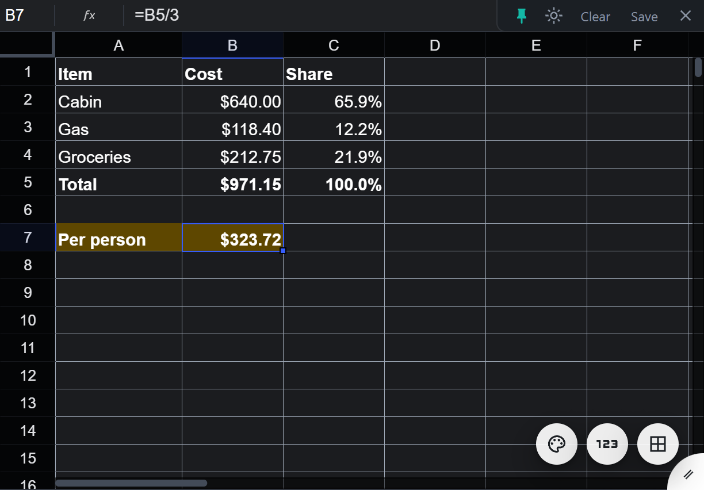
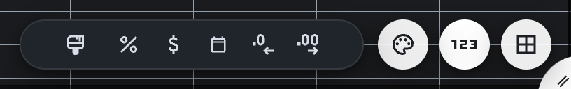

# Scratch Sheet

A floating, always-on-top spreadsheet sticky note for quick math on Windows. Press a hotkey, work the numbers out with real formulas, press it again and it is gone.

It is for anyone who keeps a spreadsheet tab or the Windows calculator open all day just to add up a few numbers: splitting a bill, checking a quote, totaling an order, working out a percentage.

**[Download the latest release](../../releases/latest)** for Windows 10 or 11 (64-bit). Free and open source under the MIT license.



## Why Scratch Sheet

- **One hotkey away.** Ctrl+Alt+Space shows or hides it from anywhere. After the first launch it starts hidden when you log in and waits in the system tray.
- **Real spreadsheet formulas.** Hundreds of them (SUM, AVERAGE, IF, ROUND, VLOOKUP, and more), plus number formats, bold and italic, cell colors, borders, merged cells, and conditional formatting, from the [Univer](https://github.com/dream-num/univer) spreadsheet engine.
- **Types like Google Sheets.** Typing `$12,133` or `5.7%` keeps the number and applies the format, and the arrow keys point at cells while you write a formula.
- **Stays out of the way.** It has no title bar, floats above your other windows, and remembers its size and position.
- **Keeps your work.** Every change saves automatically, including your scroll position and active cell, so it reopens exactly where you left off.
- **Exports to Excel.** **Save** writes an .xlsx with values, formulas, number formats, bold and italic, font sizes, text and fill colors, borders, merged cells, and column widths.

## A scratchpad spreadsheet for Windows

Scratch Sheet is a scratchpad for the numbers you do not need to keep: a running total, a tip split, a quick percentage, a column of figures pasted from an email. Think of it as an always-on-top calculator that shows its work, or a sticky note that understands formulas. Close it and the numbers are still there next time.

## Install

1. Download `Scratch-Sheet-Setup-<version>.exe` from the [latest release](../../releases/latest) and run it. It installs for your user account only, so there is no admin prompt.
2. The installer is not code-signed, so Windows SmartScreen may say "Windows protected your PC". Click **More info**, then **Run anyway**. Each release's notes list the installer's SHA-256 checksum, so you can check the file before you run it.
3. Open **Scratch Sheet** from the Start menu once. From then on it starts hidden when you log in.
4. Press **Ctrl+Alt+Space** to show or hide the sheet.

To update, quit Scratch Sheet from the tray menu, run the new installer, and start it from the Start menu.

## Using it

- **Show or hide:** press **Ctrl+Alt+Space**, or left-click the tray icon.
- **Move:** drag the rounded tab in the bottom-right corner, or hold **Ctrl** and drag anywhere on the sheet. Resize from any edge.
- **Corner strip (top right):** the pin keeps the sheet on top of other windows, the sun or moon switches between dark and light mode, **Clear** empties the sheet in one click (**Ctrl+Z** brings it back), **Save** exports an .xlsx, and **×** hides the sheet to the tray.
- **Three tool circles (bottom right):** drag them anywhere as a group. Each one opens its own set of tools.
  - The palette: smaller and larger text, text color, and fill color.
  - **123:** format painter, percent, currency, date, fewer decimals, and more decimals.
  - The grid: conditional formatting, borders, and merge cells.
- **Format painter:** select a cell, click the brush in the 123 tools, then click another cell to copy the formatting onto it. Double-click the brush to keep painting, and press **Esc** to stop.
- **Right-click a cell:** **Number format** (Automatic, Number, Percent, Currency, Currency (rounded), Date, Time, Date time, Plain text) and **Align** (Left, Center, Right).
- **Keyboard:** **Ctrl+B** bold, **Ctrl+I** italic, **Ctrl+Z** undo, **Ctrl+Y** redo.
- **Tray menu (right-click the tray icon):** Show / Hide, Always on top, Dark mode, Launch at startup, Open data folder, Edit config, and Quit. Closing only hides the sheet. **Quit** is in the tray menu.



### Change the hotkey

Right-click the tray icon, choose **Edit config**, and change `hotkey` using Electron accelerator syntax (for example `Control+Shift+F12`). Save the file, quit from the tray, and start Scratch Sheet again. If another app already owns the combo, Scratch Sheet shows a warning when it starts.

### Use a Logitech G key

G keys only send what G HUB assigns to them, so map a G key to the combo `Ctrl+Alt+Space` in G HUB.

## Your data

- The sheet and settings are stored in `%APPDATA%\Scratch Sheet\`: `sheet.json` holds the sheet, and `config.json` holds the hotkey, theme, window position, and the **Always on top** and **Launch at startup** settings. **Open data folder** in the tray menu goes straight there.
- There is no account or sign-in.
- The folder is kept through updates and uninstalls. To remove your data for good, delete it after uninstalling.

## Uninstall

Open **Settings > Apps**, find **Scratch Sheet** in the list of installed apps, and choose **Uninstall**. Your sheet stays in `%APPDATA%\Scratch Sheet\` (see [Your data](#your-data)).

## Scope

Scratch Sheet deliberately stays small:

- One sheet, with no tabs. It does not open files; **Save** exports a copy.
- Text alignment and conditional formatting rules stay in the app and are not written to the .xlsx.
- Windows only.
- No automatic updates. New versions are posted on the [Releases](../../releases) page, and changes are listed in [CHANGELOG.md](CHANGELOG.md).
- The installer is not code-signed.

## Build from source

You need Windows and Node.js 22.12 or later.

```powershell
npm install          # installs dependencies and applies the Univer patch in patches/
npm run build        # builds the app and the installer: release\Scratch Sheet Setup <version>.exe
```

For development:

```powershell
npm run dev          # builds the renderer and starts the app with electron .
npm run build:dir    # unpacked build in release\win-unpacked (no installer)
npm test             # DevTools Protocol smoke test against an instance started with --remote-debugging-port=9222
# QUIET=1 never shows the window (skips right-click steps); CDP_PORT picks another port;
# SCRATCH_DATA=<dir> checks the sheet.json of an instance started with --user-data-dir=<dir>
```

```
electron/main.js     window, tray, hotkey, IPC, login item
electron/preload.js  contextBridge API exposed as window.scratch
electron/export.js   snapshot -> .xlsx (ExcelJS), pure Node
src/                 renderer: Univer grid, toolbar, autosave
patches/             fix for Univer's arrow keys wrapping at the sheet edges (applied by patch-package)
build/make-icon.js   generates build/icon.png with no dependencies
test/                CDP smoke and restart tests
```

## Credits

Built with [Electron](https://github.com/electron/electron), [Univer](https://github.com/dream-num/univer), [ExcelJS](https://github.com/exceljs/exceljs), [Vite](https://github.com/vitejs/vite), [electron-builder](https://github.com/electron-userland/electron-builder), [patch-package](https://github.com/ds300/patch-package), and [Material Symbols](https://github.com/google/material-design-icons) icons by Google. The full list of bundled packages and their licenses is in [THIRD-PARTY-NOTICES.md](THIRD-PARTY-NOTICES.md).

## License

MIT. See [LICENSE](LICENSE). Made by [sleetcrash](https://github.com/sleetcrash).
